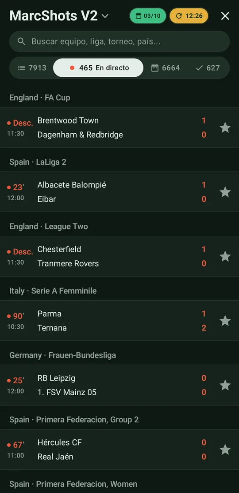
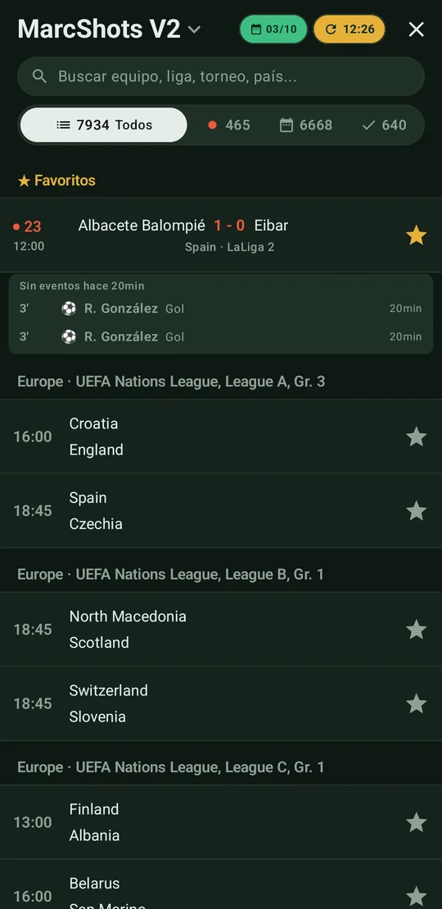
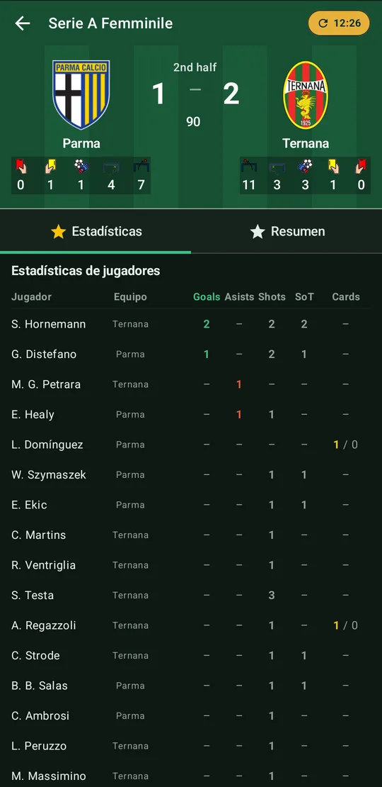
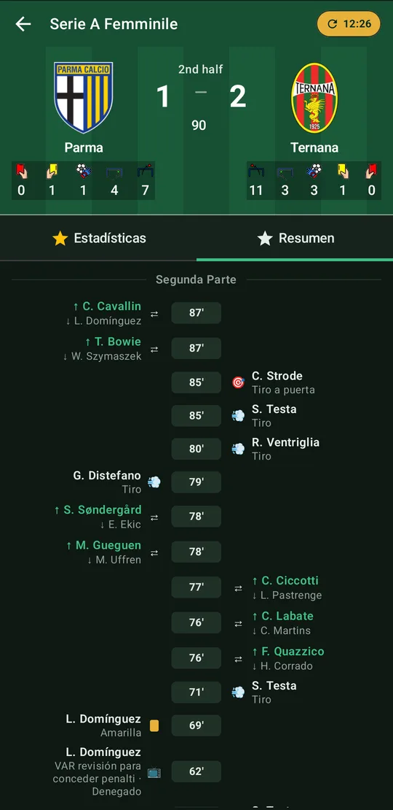

# MarcShots

App Android para seguir partidos de fútbol en directo: marcadores, incidencias y tiros.

  
  
  
  

Este repositorio **no contiene el código de la app**. Sirve para tres cosas:

| Qué | Dónde |
| --- | --- |
| Página de la app con el botón de descarga | **https://marzeta-hub.github.io/marcshots-releases/** |
| Cada versión publicada, con sus novedades y el APK | [Releases](https://github.com/MarZeta-hub/marcshots-releases/releases) |
| Última versión en formato máquina (la lee la app) | [`version.json`](version.json) |

## Descargar

👉 **[Descargar la última versión (APK)](https://github.com/MarZeta-hub/marcshots-releases/releases/latest/download/marcshots.apk)**

1. Abre el enlace desde el móvil y descarga `marcshots.apk`.
2. La primera vez, Android te pedirá permiso para *instalar aplicaciones desconocidas* desde el
   navegador. Acéptalo.
3. Las actualizaciones se instalan encima de la versión anterior, sin perder tus datos.

Dentro de la app: **toca el título → Aplicación → Comprobar actualizaciones**.

## Requisitos

- Android 12 (API 31) o superior
- Conexión a internet

## Funciones

- Lista de partidos del día, con filtros por estado y búsqueda
- Detalle del partido: marcador, incidencias y tiros
- Tabla de últimos eventos por partido, con filtros y retraso anti-spoilers
- Partidos marcados que siguen visibles en la lista de hoy

## Cómo se versiona

Cada publicación en la rama `main` del repositorio de código genera una versión nueva:

- **`versionCode`**: número entero que siempre sube. Es el que usan Android y la app para saber
  si hay una actualización.
- **`versionName`**: nombre legible de la versión.
- Las novedades de cada versión salen de los commits y se agrupan en *Nuevo*, *Mejoras* y
  *Correcciones*.

`version.json` siempre describe la **última** versión publicada. El historial completo está en
[Releases](https://github.com/MarZeta-hub/marcshots-releases/releases).
